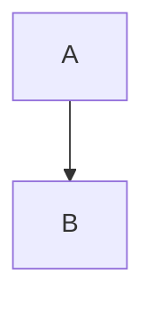

# Obsidian Flavoured Markdown

Links: [[/wiki/Topic.md|Topic]], [[/wiki/Topic.md#Some Heading|Topic#Some Heading]], [[/wiki/Topic.md#^b-1|that block]], [[/unowned/Loose.md|Loose]], [[/:!Missing note|Missing note]], [[/:?Duplicate|Duplicate]], and a file [[/docs/spec.pdf|spec]].

Standard links resolve too: [the topic](/wiki/Topic.md) and [a spaced name](</wiki/My Topic.md>).

| Table | Link |
| --- | --- |
| row | [[/wiki/Topic.md\|Topic]] |

![[/img/photo.png|320]]

![[/audio/clip.mp3]]

![[/docs/spec.pdf#page=2]]

![[/wiki/Embedded.md]]

![[/memory/tasks.base#Open]]

![[/boards/plan.canvas]]

> [!warning] Watch out
> Callout body with [[/wiki/Topic.md|a link]].

> [!faq]- Folded question
> The answer.
> > [!tip] Nested tip
> > Inside.

Text with ==a highlight *across* emphasis== and %%a hidden comment%% here, tagged #project/alpha and #todo.

A block to cite. ^cite-me

Inline $e^{i\pi} + 1 = 0$ and display:

$$\sum_{n=1}^{\infty} \frac{1}{n^2} = \frac{\pi^2}{6}$$

